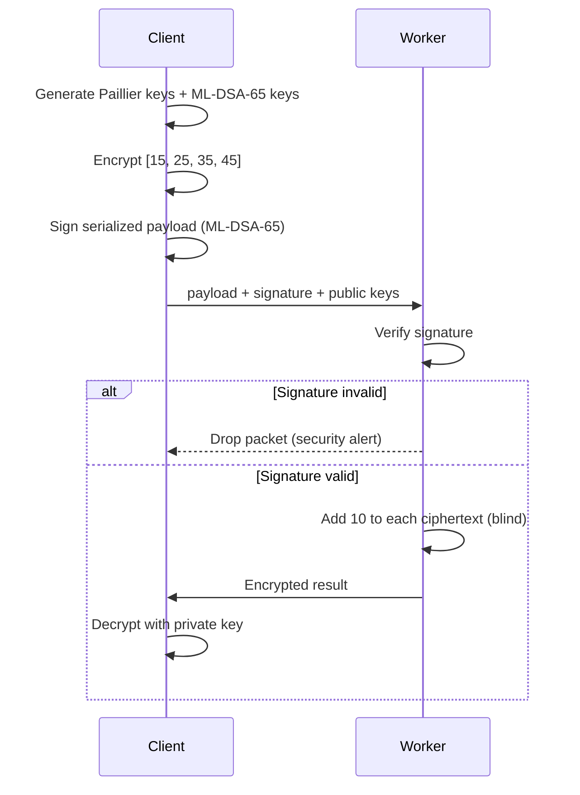

<div align="center">

# 🔐 Private Compute + Post-Quantum Signatures

**Compute on encrypted data. Trust only signed payloads.**


-purple)


</div>

A Python client-worker pipeline where a worker adds to **Paillier-encrypted** numbers without ever seeing the plaintext, and only accepts payloads that carry a valid **ML-DSA-65** post-quantum signature.

> [!NOTE]
> This is a learning project and proof of concept, not a production system. See the [threat model](#-threat-model) and [limitations](#-limitations) for exactly what it does and does not protect.

## ⚡ In 30 seconds

- 🔒 **Privacy:** the worker computes on ciphertexts and never holds the private key.
- ✍️ **Integrity:** every payload is signed with ML-DSA-65 (Dilithium). A single changed bit is rejected.
- 🧪 **Result:** `[15, 25, 35, 45]` goes in encrypted, the worker adds 10 blind, and the client decrypts `[25, 35, 45, 55]`.

DRAG YOUR TERMINAL SCREENSHOT HERE

## 📑 Contents

[How it works](#-how-it-works) · [Who knows what](#-who-knows-what) · [Threat model](#-threat-model) · [Getting started](#-getting-started) · [Design decisions](#-design-decisions) · [Limitations](#-limitations) · [Roadmap](#-roadmap) · [References](#-references)

## 🔄 How it works



```
Worker:  [*] Signature Validated!
Client:  [Client] Successfully Decrypted Result: [25, 35, 45, 55]
```

If the payload is altered:

```
[!] SECURITY ALERT: Post-Quantum Signature Verification FAILED!
```

## 👁️ Who knows what

| | Client | Worker |
|---|---|---|
| Plaintext numbers | ✅ | ❌ |
| Paillier private key | ✅ | ❌ |
| ML-DSA private key | ✅ | ❌ |
| Ciphertexts | ✅ | ✅ |
| Public keys and signature | ✅ | ✅ |
| The operation applied (+10) | ✅ | ✅ |

The worker learns the *operation* it performs, but not the data it performs it on.

## 🛡️ Threat model

| Scenario | Outcome | Why |
|---|---|---|
| Worker is curious and tries to read the data | ✅ Protected | It only sees ciphertexts and has no private key |
| Payload is modified in transit | ✅ Detected | The ML-DSA-65 signature no longer verifies |
| Future quantum attacker forges a signature | ✅ Resistant | ML-DSA is a NIST post-quantum signature scheme |
| Future quantum attacker breaks the encryption | ❌ Not protected | Paillier is **not** post-quantum |
| Attacker replaces the **whole package**, key included | ❌ Not detected | The worker trusts the public key inside the payload |
| Attacker replays an old valid package | ❌ Not detected | No nonce or timestamp |

## 🚀 Getting started

```bash
git clone https://github.com/Tejesh-R/private-compute-pq-signatures.git
cd private-compute-pq-signatures
python3 -m venv fhe_env
source fhe_env/bin/activate
pip install phe liboqs-python
```

> `liboqs-python` needs the underlying `liboqs` library. If the import fails, follow the [setup guide](https://github.com/open-quantum-safe/liboqs-python).

```bash
python3 client.py        # encrypts, signs, writes payload_to_worker.pkl
python3 worker_node.py   # verifies, computes blind, writes payload_to_client.pkl
python3 client.py        # decrypts the result
```

*(Adjust the order and file names if yours differ.)*

```
.
├── client.py         # key generation, encryption, signing, decryption
├── worker_node.py    # signature verification and blind computation
└── README.md
```

## 🧠 Design decisions

| Choice | Reason |
|---|---|
| **Paillier instead of full FHE** | Simple and fast to demonstrate, and addition on ciphertexts is enough to show the idea. Schemes like BFV or CKKS allow far more operations but are heavier to set up. |
| **ML-DSA-65 for signatures** | NIST-standardised and designed to resist quantum attacks, so forged payloads stay a problem even for a future quantum adversary. |
| **Verify before computing** | A tampered packet is dropped before the worker spends effort on it or is influenced by it. |
| **`pickle` files as the "network"** | The quickest way to simulate sending a payload. It is **not** safe for untrusted input. |

## 🚧 Limitations

- **Partially homomorphic only.** Paillier supports addition and multiplication by a plain number, not arbitrary computation.
- **Only the signature layer is post-quantum.** Paillier relies on assumptions a large quantum computer could break.
- **Key trust gap.** Verification proves the payload matches *a* key, not that the key belongs to the right client. A real system must pin or certify the sender's public key.
- **No replay protection.** Nothing stops an old valid package being sent again.
- **`pickle` is unsafe for untrusted data**, and the data is hardcoded with everything running locally.

## 📚 What I learned

- Encryption can protect data *while it is being computed on*, not only at rest
- The difference between partially and fully homomorphic encryption
- A signature check only helps if the verifier already trusts the signer's key
- How a post-quantum signature slots into an ordinary client-worker flow

## 🛣️ Roadmap

- [ ] Pin a trusted client public key on the worker
- [ ] Add a nonce or timestamp to block replays
- [ ] Sign and verify the worker's response
- [ ] Replace `pickle` with JSON or another safe format
- [ ] Support more homomorphic operations (sums, scalar multiplication)
- [ ] Send payloads over a real socket instead of files

## 📖 References

- [python-paillier (`phe`) documentation](https://python-paillier.readthedocs.io)
- [Open Quantum Safe: liboqs-python](https://github.com/open-quantum-safe/liboqs-python)
- [NIST FIPS 204: ML-DSA](https://csrc.nist.gov/pubs/fips/204/final)

## 👤 Author

**N Tejesh Reddy**
B.Tech Cyber Security Student | Python | Cryptography
[GitHub](https://github.com/Tejesh-R)
